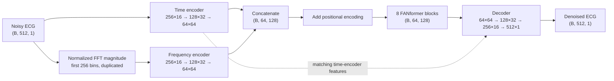

# Model and data flow

This guide describes the **root implementation** of `Dual_FreqDAE` in
[deepFilter/dl_models.py](../deepFilter/dl_models.py), together with the root data
preparation and training tools. It documents the current code; it does not establish
which experiment or checkpoint produced every result in the accepted paper.

For commands, see the [execution guide](README_Dual_FreqDAE.md).
For file locations, see the [project README](../README.md).

## 1. From noisy ECG to denoised ECG

The model receives a noisy ECG window and a frequency representation computed from
that same window. Two convolutional encoders extract features, a stack of FANformer
blocks mixes them, and a decoder reconstructs the ECG waveform.

The following shapes use a batch size `B` and the default length of 512 samples.
Inside each encoder, the labels show `sequence length × feature channels`.



Source: [Dual_FreqDAE](../deepFilter/dl_models.py#L1263).

## 2. Frequency input and learned FAN features

For each noisy window `x` of length `n=512`, preprocessing constructs:

```text
m = abs(FFT(x) / n)[:n/2]
frequency_input = concatenate(m, m)
```

This includes DC and excludes the Nyquist bin. The half-spectrum is repeated in
the same order; it is not mirrored, and its amplitudes are not doubled. Phase is
discarded. Both model inputs therefore have shape `(B,512,1)`.
The `fs` argument constructs a frequency axis that is not used in the returned
features; changing it does not resample the signal.

Source: [make_fourier](../Data_Preparation/data_preparation_with_fourier.py#L45).

The **FAN layers inside the transformer** perform a separate learned operation.
For an output width `d`, they compute:

```text
p_dim = floor(0.25 × d)
p = Dense(p_dim)(features)
g = GELU(Dense(d − 2 × p_dim)(features))
FAN(features) = concatenate(cos(p), sin(p), g)
```

Here `p` is a learned projection of latent features, not the input ECG's FFT.
The cosine, sine, and GELU components occupy 25%, 25%, and 50% of the output
channels at the widths used here. Both FAN layers use `gated=False`.

Each FANformer block applies LayerNorm, self-attention, dropout, and a residual
addition, followed by LayerNorm, two FAN layers, dropout, and another residual
addition. The FAN widths are `128 → 512 → 128`. Defaults are eight attention
heads, key dimension 64 per head, and zero dropout. The accepted `hidden_dim`
and `ff_dim` arguments do not set the active FAN widths.

Sources: [FANLayer](../deepFilter/dl_models.py#L71),
[FANformer_encoder](../deepFilter/dl_models.py#L867).

## 3. Convolutional gates, noise, and reconstruction

Each encoder has three stages with 16, 32, and 64 channels. Each stage uses two
parallel convolutions with kernel size 13, stride 2, and same padding. A sigmoid
gate from one convolution multiplies the other convolution's features. The feature
branch is linear in stages 1–2 and uses ELU in stage 3.

In the time encoder, the gate's pre-sigmoid activations are multiplied by
`1 + U(-1,1)` during training. This multiplicative noise is disabled for inference.
Batch normalization follows all three time-encoder stages. The frequency encoder
uses no active noise injection and applies batch normalization after stages 1–2.

The two final encoder outputs are concatenated and receive sinusoidal positional
encoding before attention. The implementation initializes that encoding with
`signal_size=512` and takes the first 128 channels for the fused features.

The decoder has four transposed-convolution stages with channels `64,32,16,1`
and strides `1,2,2,2`. The first three use ELU, add the matching time-encoder
features, and apply batch normalization. The last stage has a linear activation.
The local transposed-convolution helper expands to 2D, applies `Conv2DTranspose`,
and squeezes the extra dimension.

Sources: [AddGatedNoise](../deepFilter/dl_models.py#L934),
[frequency_branch](../deepFilter/dl_models.py#L1233),
[decoder](../deepFilter/dl_models.py#L1346).

## 4. Training data and split

The data loader requires `data/QTDatabase.pkl`, `data/CombinedNoise_Train.pkl`,
and `data/CombinedNoise_Test.pkl`. QTDatabase maps record identifiers to beats.
For each beat, the loader subtracts the average of its first and last sample,
then inserts it into a zero-filled 512-sample window starting at index 16.
Beats longer than 496 samples are skipped. This is endpoint centering, without
z-score or min–max normalization.

These 14 records form the held-out test set; other records supply training beats:

```text
sel123, sel233, sel302, sel307, sel820, sel853, sel16420,
sel16795, sele0106, sele0121, sel32, sel49, sel14046, sel15814
```

The loader adds consecutive 512-sample slices from the corresponding train or
test noise array, wrapping the noise index when necessary. It does not actively
apply per-beat SNR scaling. Although random scaling arrays are generated with
NumPy seed 1234, they are unused; rebuilding the data writes `rnd_test.npy`.

The training tool splits the training beats 70/30 with `random_state=1` for
training and validation. It applies the same split to the Fourier arrays to keep
them aligned. Validation is a **beat-level split**, not a separate record holdout.

Sources: [data loader](../Data_Preparation/data_preparation_with_fourier.py#L73),
[validation split](../tools/train_dual_freqdae.py#L81).

The optional [QT preparation function](../Data_Preparation/Prepare_QTDatabase.py#L38)
extracts first-channel beats using P-wave annotations, shifts boundaries 40 ms
earlier, excludes segments containing two or more normal QRS annotations, and
resamples beats to 360 Hz with reflected padding. Calling it overwrites the QT
pickle. The [NSTDB helper](../Data_Preparation/Prepare_NSTDB.py#L79) writes
`CombinedNoise.pkl`, not the required train/test noise pickles. These files define
functions without a command-line entry point; they are not a complete automatic
rebuild of the current prepared dataset.

## 5. Tensor contracts and objective

| Object | Shape / meaning |
| --- | --- |
| `X_train`, `X_test` | `(N,512,1)`, noisy ECG windows |
| `y_train`, `y_test` | `(N,512,1)`, clean ECG targets |
| `F_train_x`, `F_test_x` | `(N,512,1)`, frequency inputs derived from noisy ECG |
| `F_train_y`, `F_test_y` | `(N,512,1)`, clean frequency features retained in the dataset |
| Model input | `[X, F_x]`; clean Fourier arrays are not training targets |
| Model output | `(N,512,1)`, predicted clean waveform |
| Inference CLI output | `(N,512)` saved as float32 `.npy` |

The loader returns `(Dataset, valid_train_indices, valid_test_indices)`, where
`Dataset` contains `[X_train, y_train, X_test, y_test, F_train_x, F_train_y,
F_test_x, F_test_y]`.

For one beat, with error `e = y − prediction`, the training loss is:

```text
L = sum_t(e_t²) + 50 × max_t(e_t²)
```

Despite the name `combined_ssd_mad_loss`, the second term is maximum **squared**
error, not absolute error. Training uses Adam with initial learning rate `1e-3`,
batch size 128, validation-loss checkpointing, early stopping, and learning-rate
reduction. See [training implementation](../tools/train_dual_freqdae.py#L48).

## 6. Metrics and checkpoint scope

The training tool reports RMSE, PRD, cosine similarity, and SNR. Its existing
[metric functions](../utils/metrics.py) must be used when comparing saved results:

- `RMSE = sqrt(mean_t((y − prediction)²))` for each beat.
- `PRD = 100 × sqrt(sum_t((prediction − y)²) / sum_t((prediction − mean(y))²))`.
  Here `mean(y)` is global over the supplied array. This implementation uses
  prediction values in the denominator and differs from reference-energy PRD.
- Cosine similarity compares each clean beat with its reconstructed beat.
- `SNR = 10 × log10(sum_t(y²) / sum_t((y − prediction)²))`. A zero error sum is
  replaced by `1e-10`. This is output reconstruction SNR, not SNR improvement;
  improvement would also require the input SNR.

Weights must match the model implementation and experiment configuration. The
root model always concatenates time and frequency features. The separate
[standalone implementation](../dual_freqdae_repo/deepFilter/dl_models.py#L1264)
adds `concat_mlp` and `cross_attn` fusion variants alongside `concat`; checkpoints
from these variants should not be treated as interchangeable with the root model.

The inference runner constructs Fourier features automatically. Its segmentation
option returns independent denoised windows, without overlap-add reconstruction,
resampling, or amplitude normalization. See the [execution guide](README_Dual_FreqDAE.md)
for input requirements and commands.
